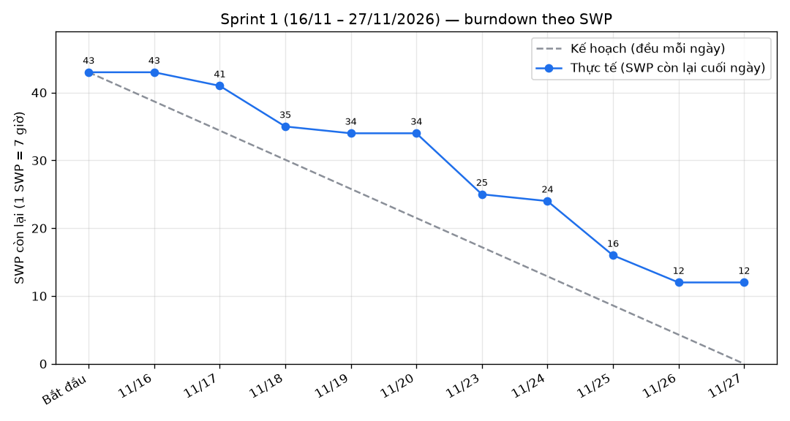

# Báo cáo tiến độ — Sprint 1

- **Iteration trên Project:** `Sprint 1` ([GitHub Project](https://github.com/users/uyenhtt-0921/projects/2), field `Sprint`)
- **Khoảng thời gian giả lập:** 2026-11-16 → 2026-11-27 (10 ngày làm việc)

> Dự án: hệ thống vận hành chợ 株式会社 桜水産市場 (Product A). Đây là sprint **giả lập** trong bài thực hành: diễn biến được soạn
> để luyện báo cáo, số liệu sinh bằng script từ một nhật ký duy nhất và khớp trạng thái trên Project.
> Đơn vị khối lượng: **SWP** (điểm khối lượng chuẩn, chấm theo độ rộng × độ khó của từng việc). **1 SWP = 7 giờ công**
> (gồm làm, unit test, sửa lỗi; chưa gồm dự phòng).

**Tóm tắt**

- **Hoàn thành 31 / 43 SWP đã nhận (72%), 10 / 14 việc.** Nền tảng chính đã sẵn sàng: môi trường Supabase vùng Tokyo, nhật ký kiểm toán
  (audit log), thư viện ngày giờ / tiền tệ, bộ component form và danh sách, quy ước thao tác bằng bàn phím cho màn hình nhập liệu.
- **Chậm so với kế hoạch 12 SWP**, chủ yếu do chờ xác nhận dùng cloud vùng Tokyo (trễ 3 ngày) làm việc quản lý schema DB bắt đầu muộn.
- **Câu hỏi gửi Quý công ty: 5 câu — 3 câu đã có trả lời đầy đủ, 1 câu mới trả lời một phần, 1 câu chưa trả lời.** Hai câu còn mở
  ảnh hưởng việc của sprint sau (mục 3): định nghĩa "kỳ sau" của 完納奨励金, và người xác nhận tư cách người mua khi 完了確定 giao hàng.

## 1. Trạng thái cuối sprint

Năng lực đội: 5 vai trò phát triển × 10 ngày × 7 giờ = 350 giờ = **50 SWP**. Đã nhận **43 SWP** (86% năng lực).

| Trạng thái | Số issue | Tổng SWP | Giờ | Ghi chú |
|---|---:|---:|---:|---|
| Hoàn thành (Done) | 10 | 31 | 217 | Nền tảng môi trường, audit log, thư viện và component dùng chung; 3 câu hỏi đã có trả lời |
| Đang làm (In Progress) | 2 | 8 | 56 | #32 bắt đầu muộn vì chờ #31; #40 làm nối sau #39. Cả hai chuyển sang Sprint 2 |
| Bị chặn, chờ trả lời (Blocked) | 2 | 4 | 28 | #115 (完納奨励金, trả lời một phần) và #139 (R-19, chưa trả lời) |
| **Tổng** | **14** | **43** | **301** | 72% SWP đã nhận hoàn thành |

| Việc | Nội dung | Phụ trách (giả định) | SWP | Cuối sprint | Ghi chú |
|---|---|---|---:|---|---|
| #28 | Thiết kế môi trường dev / stg / prod | Infra | 2 | Hoàn thành | |
| #31 | Supabase dev / stg / prod vùng Tokyo, MFA | Infra | 6 | Hoàn thành | Bắt đầu trễ 3 ngày, chờ xác nhận dùng cloud vùng Tokyo |
| #35 | Thư viện ngày giờ JST, định dạng ngày kiểu Nhật, tiền JPY | BE2 | 3 | Hoàn thành | |
| #38 | Component form, hiển thị lỗi bằng tiếng Nhật | FE | 3 | Hoàn thành | |
| #39 | Component bảng danh sách (tìm kiếm, lọc, phân trang) | FE | 3 | Hoàn thành | |
| #41 | Quy ước thao tác bằng bàn phím cho nhập lô, chốt giao dịch, ghi giao hàng | FE-Lead | 4 | Hoàn thành | |
| #48 | Nền nhật ký kiểm toán chỉ thêm, không sửa / xóa | BE1 | 6 | Hoàn thành | |
| #68 | Câu hỏi: tư cách 買出人 / 卸売業者 | BE2 | 1 | Hoàn thành | Có trả lời 11-19, đã cập nhật spec |
| #86 | Câu hỏi: ai tạo / duyệt điều chỉnh thuộc tính lô | BE2 | 1 | Hoàn thành | Có trả lời 11-24 |
| #210 | Câu hỏi: làm việc khi mất mạng ngắn | FE-Lead | 2 | Hoàn thành | Có trả lời 11-25 |
| #32 | Quản lý schema DB, dữ liệu mẫu, khung test DB | BE2 | 5 | Đang làm | Bắt đầu 11-25 vì phụ thuộc #31; chuyển sang Sprint 2 |
| #40 | Component dialog, thông báo, chế độ chỉ xem | FE | 3 | Đang làm | Chuyển sang Sprint 2 |
| #115 | Câu hỏi: 適格金額, 支払期日, "kỳ sau" của 完納奨励金 | BE1 | 2 | Bị chặn | Đã có trả lời 2 / 3 ý; "kỳ sau" chưa trả lời |
| #139 | Câu hỏi: người xác nhận tư cách người mua khi 完了確定 | BE1 | 2 | Bị chặn | Chưa có trả lời (đã nhắc 11-24) |

## 2. Burndown

| Ngày | 16/11 | 17/11 | 18/11 | 19/11 | 20/11 | 23/11 | 24/11 | 25/11 | 26/11 | 27/11 |
|---|---:|---:|---:|---:|---:|---:|---:|---:|---:|---:|
| SWP còn lại | 43 | 41 | 35 | 34 | 34 | 25 | 24 | 16 | 12 | 12 |

**Giải thích độ lệch:**
- **16/11–20/11, đường thực tế nằm trên kế hoạch.** Môi trường Supabase (#31) phải chờ xác nhận chính sách dùng cloud vùng Tokyo.
  Ước lượng ban đầu đã ghi điều kiện này là "cần xác nhận"; Quý công ty xác nhận chiều 19/11. Trong lúc chờ, đội làm trước các việc
  không cần môi trường (thư viện, component, audit log), nên đường vẫn đi xuống, nhưng chậm.
- **23/11–25/11, rút ngắn khoảng cách** khi audit log, component danh sách và môi trường Supabase hoàn thành.
- **26/11–27/11, đường đi ngang ở 12 SWP**: việc quản lý schema DB (#32) chỉ bắt đầu được từ 25/11, và 2 câu hỏi chưa có
  trả lời đầy đủ.

## 3. Rủi ro trễ và hành động

| Rủi ro | Issue | Ảnh hưởng tới mốc nào | Hành động | Ai làm, khi nào |
|---|---|---|---|---|
| Chưa xác định người xác nhận tư cách người mua khi 完了確定 giao hàng. Nếu kéo dài, ngày có giao hàng chưa xong không khóa được | #139; quy tắc trong #127 (kiểm tư cách khi 完了確定) và #147 (chặn khóa ngày) đang tạm giữ cách làm hiện có cho tới khi có trả lời | Sprint có chức năng giao hàng và khóa ngày (dự kiến Sprint 3) | Gửi lại câu hỏi kèm 2 phương án để Quý công ty chọn: (a) người khác người thao tác, có vai trò chỉ định; (b) chỉ trưởng bộ phận đối soát | PL — gửi trong họp tuần 2026-12-01, cần trả lời trước 2026-12-04 |
| Chưa rõ "kỳ sau" nhận phần chênh lệch 完納奨励金 là kỳ nào | #115 → chặn #116 (xác định "đúng hạn"), qua đó ảnh hưởng #117 (làm tròn) và #118 (hàm chênh lệch sang kỳ sau) | Sprint làm phần tính 完納奨励金 (dự kiến Sprint 2–3) | Gửi bảng ví dụ số liệu (3 tình huống) để Quý công ty xác nhận thay cho câu hỏi mở | BrSE — gửi 2026-11-30, cần trả lời trước 2026-12-04 |
| Việc nền DB trễ sang Sprint 2 làm các việc tạo bảng nghiệp vụ (tài khoản, người tham gia, lô) bắt đầu muộn | #32 → #42, #44, #73, #49 | Sprint 2 | Ưu tiên #32 đầu Sprint 2 (BE2 + hỗ trợ BE1), mục tiêu xong trước 2026-12-02 | BE2, BE1 — Sprint 2 |
| Tổng khối lượng toàn bộ backlog (940 SWP ≈ 6.580 giờ) gấp khoảng 2,2 lần phần phát triển trong bản ước lượng ban đầu. Với tốc độ sprint này (31 SWP), cần khoảng 29 sprint; với toàn bộ năng lực (50 SWP), khoảng 18 sprint | Toàn backlog (17 epic) | Mốc vận hành chính thức 2027-08-09 | Rà lại phạm vi cùng Quý công ty: tách hạng mục ưu tiên cao nhất cho đợt đầu, xem xét tăng người cho phần đối soát, chuyển đổi dữ liệu và 完納奨励金 (ba phần lệch nhiều nhất) | PL — trình phương án trong họp tuần 2026-12-08 |
| Còn 13 câu hỏi chưa gửi, chặn trực tiếp 33 việc của các sprint sau (báo cáo, xuất kế toán, thông báo, chuyển đổi dữ liệu…) | 13 việc làm rõ trên Project (nhãn `kind:clarification`) | Sprint 2–4 | Gửi theo lô, mỗi tuần 4 câu, ưu tiên câu chặn việc của sprint gần nhất; theo dõi trên Project | BrSE — bắt đầu 2026-11-30 |

**Kế hoạch Sprint 2 (2026-11-30 → 2026-12-11) để xử lý các rủi ro trên**

- Hoàn tất #32 (schema DB) và #40 (component còn lại).
- Bắt đầu các bảng và chức năng nền: tài khoản và vai trò (#42), khóa ngày (#49), người tham gia (#44), lô hàng (#73), khung ứng dụng (#30).
- Tiếp tục các câu hỏi #115, #139 và gửi lô câu hỏi tiếp theo.
